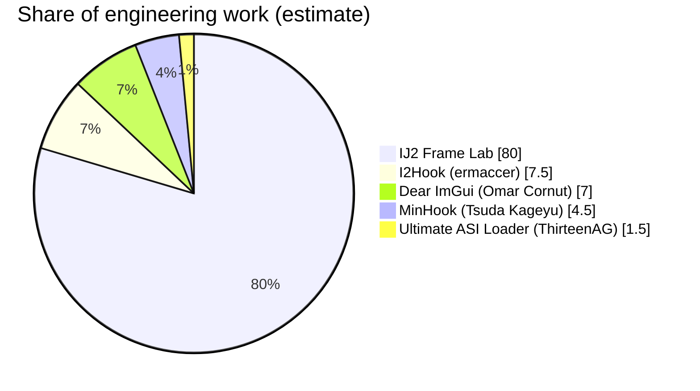

# IJ2 Frame Lab

Live frame data, hitboxes and hurtboxes for **Injustice 2** (PC, Steam) Practice mode.

> **Practice mode only.** The overlay and every input feature turn themselves off in any other game mode. Never use mods online.

Download the ready-to-use build from [Nexus Mods](https://www.nexusmods.com/games/injustice2/mods/13). This repository is the source code.

## Features

- A frame data panel styled after the game's own move list: start-up, active, recovery, hit/block advantage, cancel and total, all measured live.
- The game's official move-list data for every normal, string, special and super of every loaded character, read from memory and shown in pad notation.
- Knockdown advantage, meaty and lingering projectile handling, and gaps in strings.
- Hitboxes and hurtboxes, including projectiles, with separate opacity controls.
- Freeze and frame-step, HDR-safe screenshots, and an optional extended input buffer.
- A controller-friendly in-game menu (F2).

## Building

Requirements: CMake 3.16+ and a 64-bit C++17 compiler.

- **MinGW-w64** (the toolchain the releases are built with), cross-compiling from Linux:
  ```
  cmake -B build -DCMAKE_TOOLCHAIN_FILE=cmake/mingw-w64-x86_64.cmake -DCMAKE_BUILD_TYPE=Release
  cmake --build build -j
  ```
- **Visual Studio 2022** (x64) should also work but hasn't been tested yet:
  ```
  cmake -B build -A x64
  cmake --build build --config Release
  ```

The build produces two files:

| File | What it is |
|---|---|
| `IJ2FrameLab.asi` | A small loader picked up by [Ultimate ASI Loader](https://github.com/ThirteenAG/Ultimate-ASI-Loader). |
| `IJ2FrameLab_core.dll` | The mod itself. The loader can hot-reload it (Ctrl+F5) without restarting the game. |

Copy both, plus `dist/IJ2FrameLab.ini`, into `Injustice2\Binaries\Retail`.

## Source layout

| File | Purpose |
|---|---|
| `src/loader.cpp` | The `.asi` loader and hot reload |
| `src/dllmain.cpp` | DX11 Present hook, ImGui setup, window/input hooks |
| `src/ij2.cpp` | Game integration: player objects, collision objects, hurt/hit shapes, game mode, freeze/step |
| `src/game.cpp` | Frame meter, move segmentation, advantage, knockdowns, gaps, move identification |
| `src/movelist.cpp` | Reads the game's move-list frame data tables and turns names into notation |
| `src/ui.cpp` | Frame data panel, F2 menu, advanced window |
| `src/boxes.cpp` | Hitbox and hurtbox drawing |
| `src/buffer.cpp` | XInput hook: extended input buffer, menu input capture |
| `src/dinput_block.cpp` | Blocks keyboard input to the game while the menu is open |
| `src/screenshot.cpp` | Back-buffer PNG screenshots |
| `src/bot.cpp` | Scripted test input and diagnostics (command file), practice mode only |

## Third-party code and credits

| Credit | Project | How IJ2 Frame Lab uses it | Licence |
|---|---|---|---|
| [ermaccer](https://github.com/ermaccer) | [I2Hook](https://github.com/ermaccer/I2Hook) | The function signatures for the game's core systems (game tick, GameInfo, player and object lookup, positions, bones, camera, game speed) and the freeze-world hook behind freeze / frame-step, in `src/ij2.cpp`. | - |
| [ThirteenAG](https://github.com/ThirteenAG) | [Ultimate ASI Loader](https://github.com/ThirteenAG/Ultimate-ASI-Loader) | Loads the mod into the game. Required, but not included. | MIT |
| [Omar Cornut](https://github.com/ocornut) | [Dear ImGui](https://github.com/ocornut/imgui) | The overlay UI: frame data panel, menus, drawing. Included in `external/imgui`. | MIT |
| [Tsuda Kageyu](https://github.com/TsudaKageyu) | [MinHook](https://github.com/TsudaKageyu/minhook) | Hooks the game's rendering and input. Included in `external/minhook`. | BSD 2-clause |

The licences of the included libraries are in their folders.

## Contributions

How much of IJ2 Frame Lab is original work, and how much comes from the projects it builds on. The IJ2 Frame Lab share was built by Pluralmite with Claude, as described in [AI usage](#ai-usage). The pie chart is an **estimate** of engineering work by area, not a measurement. The [line counts](#lines-of-code) further down are measured.



### How the estimate was made

The mod was split into four areas, each weighted by how much of the work it represents. Each area was then divided between this project and the projects it uses.

| Area | Weight | From other projects | IJ2 Frame Lab |
|---|---|---|---|
| Frame data engine: move segmentation, start-up / active / recovery, hit and block advantage, knockdowns, meaty and lingering moves, gaps, move identification, reading the game's move list, notation | 40% | None | 40% |
| Game integration: finding the game's functions and data in memory | 25% | I2Hook 7.5% | 17.5% |
| Overlay UI: frame data panel, F2 menu, hitbox / hurtbox drawing, screenshots | 20% | Dear ImGui 7% | 13% |
| Hooking, input and loading: hooks, input buffer, menu input capture, hot reload | 15% | MinHook 4.5%, Ultimate ASI Loader 1.5% | 9% |
| **Total** | **100%** | **20.5%** | **79.5%** |

### Each project

**IJ2 Frame Lab (about 80%)**
- All frame data logic in `src/game.cpp`, and the move-list reader and notation in `src/movelist.cpp`.
- Most of the game integration in `src/ij2.cpp`:
  - The 8 collision signatures (hitboxes, hurtboxes, projectiles, strike tests).
  - Every data offset the mod reads, for example character identity, move IDs and frame state, special move names, game mode, pause state, the projectile armed flag and the move-list tables.
  - The practice-mode lock.
- The UI built with ImGui: the frame data panel, F2 menu, advanced window, hitbox drawing with opacity control, and HDR-safe screenshots.
- The input buffer and menu capture (XInput), the DirectInput keyboard block, and the hot-reloading loader.

**I2Hook by ermaccer (about 7.5%)**
- 11 of the mod's 19 function signatures are taken from I2Hook's `plugin/PatternSolver.cpp`. They cover:
  - The game tick (`MKProcDispatch`).
  - GameInfo and player info / object lookup.
  - Object positions, bones and names.
  - Camera position and game speed.
- The freeze-world hook behind F5 / F6 is ported from I2Hook's `Dispatch_Hook`.
- These are only about 20 lines, but the rest of the mod depends on them to find the players and run every frame. That is why they are weighted far above their line count: about 30% of the game integration area.

**Dear ImGui by Omar Cornut (about 7%)**
- The toolkit every window, menu, slider and box outline is drawn with, including its DirectX 11 and Win32 backends.
- Counted as about 35% of the overlay UI area. The panel's layout, styling, game-style menu and box drawing are this project's own code built on top of it.

**MinHook by Tsuda Kageyu (about 4.5%)**
- The library that installs every hook: the game's functions, DirectX Present, XInput and the window procedure.
- Counted as about 30% of the hooking and input area. What each hook does is this project's code.

**Ultimate ASI Loader by ThirteenAG (about 1.5%)**
- Loads `IJ2FrameLab.asi` into the game.
- It is not included in the mod, but the mod needs it to run.

### Lines of code

Non-blank source lines compiled into the mod:

| Project | Lines | Share |
|---|---|---|
| Dear ImGui | 47,635 | 84.0% |
| IJ2 Frame Lab | 6,078 | 10.7% |
| MinHook | 2,949 | 5.2% |
| I2Hook (signatures and hook, inside `src/ij2.cpp`) | 20 | 0.04% |
| Ultimate ASI Loader | Ships separately | n/a |

Line count favours large general-purpose libraries and undercounts small but essential pieces like the I2Hook signatures. That is why the chart above uses the weighted estimate instead.

## AI usage

IJ2 Frame Lab was built with heavy use of AI. Pluralmite came up with the project, directed it and tested it. Claude, Anthropic's AI model, did most of the hands-on work, running as an agent with access to the game folder.

### What Claude did

- **Wrote the code:** all the source in `src/`, the build setup and the hot-reloading loader.
- **Found the game data the mod reads:** probed the running game's memory with diagnostic builds and the scripted test harness in `src/bot.cpp`. This covers:
  - Data offsets: character identity, move IDs and frame state, special move names, game mode, pause state and the projectile armed flag.
  - The collision objects behind the hitboxes.
  - The move-list tables.

  The core function signatures came from I2Hook, as described in [Contributions](#contributions).
- **Tested and fixed:** built test versions, hot-reloaded them into the game, read the mod's logs and fixed the bugs found.
- **Wrote and published the documentation and release:** this README, the release README and the Nexus description. Claude also packaged the release and set up this repository and the Nexus page draft.
- **Produced the contributions estimate** above.

### What Pluralmite did

- Came up with the idea and decided what the mod should do.
- Played and tested every build in-game. Compared the results with the game's own move list and reported what was wrong, such as move names, knockdown advantage and lingering-move timing.
- Made the design decisions: pad notation, the F2 menu and its sliders, practice mode only, and making it open source.
- Reviewed and published the releases.

### Accuracy

The numbers the mod shows are not generated by AI. They are measured live from the running game, or read from the game's own move-list data. AI wrote the code that reads them, and it was checked against real gameplay.

## Licence

[MIT](LICENSE). Copyright (c) 2026 Pluralmite.
